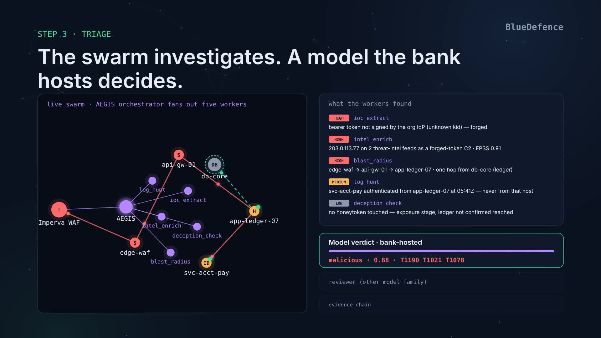
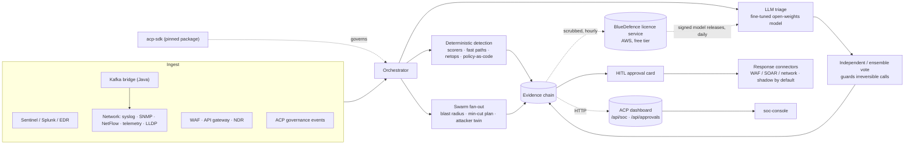

# BlueDefence

[](docs/media/BlueDefence-how-it-works.mp4)

**▶ Watch how it works (4:52)** — an alarm storm becomes one governed, evidenced decision: correlation, the agent swarm, the console, approval, audit.

**AEGIS** — an autonomous SOC and network-operations brain for banks. It reads the bank's
security *and* network telemetry, reaches a verdict deterministically where it can and with a
fine-tuned open-weights model where it must, walks the blast radius, proposes the minimum
containment, and holds every irreversible action for a human — with a hash-chained evidence trail
a regulator can replay.

Three things make it different from a SIEM with an LLM bolted on:

- **Detection is deterministic first.** Scorers, fast paths and policy-as-code produce most
  verdicts; the model triages what is left and a second model votes on anything irreversible.
- **It understands the estate, not just the alert.** Topology from LLDP, ownership from the IdP,
  crown jewels, change tickets — so a fibre cut is one incident not sixty alarms, and an unticketed
  config push followed by a BGP drop is malicious, not "network noise".
- **Every installation makes every other one smarter.** Community installations run the model on
  their own hardware, free, and send back scrubbed verdicts and analyst decisions; the pooled data
  trains the next brain, which ships back to all of them like an antivirus definition update.

Carved out of the ACP governance monorepo (`mahi80/rbi`) so the SOC product ships on its own
cadence. Full technical detail: [`aegis/README.md`](aegis/README.md).

## What it covers

| Domain | Feeds | What AEGIS does |
|---|---|---|
| Perimeter & API | WAF (Imperva / F5 / Cloudflare / AWS / Azure), API gateways | adaptive AI-agent attackers, credential stuffing, BOLA / object walks, TLS fingerprinting, auto-block of narrow external targets |
| Egress | Zeek / Suricata TLS metadata, proxy logs | C2 beacons, slow exfiltration, known-bad certificates, shadow AI and uncensored-model pulls |
| Identity & endpoints | SIEM (Sentinel / Splunk), EDR, IdP | privileged-engineer compromise (DevOps / SRE), crown-jewel access and control changes outside a ticketed window |
| Payments | core-banking / treasury streams | outflow guard and circuit breaker: high-value transfers to new beneficiaries, drain bursts (the Oct 2026 Binance pattern) |
| **Network operations** | Cisco IOS / NX-OS syslog, SNMP traps, NetFlow / IPFIX, gNMI telemetry, RANCID / Oxidized configs, LLDP / CDP | topology-aware root cause, alarm suppression (53 → 1 on a fibre cut), flaps, congestion, device silence, **bad config push** detection with rollback |
| AI governance | ACP governance events (optional) | the SOC brain itself runs as a governed agent under ACP |

## Architecture



A detection flows **ingest → orchestrator**: the deterministic layer verdicts what it can, the
model triages the rest, a vote guards the irreversible calls, a swarm walks the blast radius and
plans the **minimum cut**. Everything lands in a hash-linked **evidence chain** → **HITL** card →
**response connectors** (shadow until receipts prove an action safe). The dashboard and console
are HTTP consumers; `acp-sdk` governs the brain as an optional pinned package; the licence service
closes the learning loop across installations.

## How it is sold — and why the free tier makes the product better

| Tier | Price | Devices / eps | What you get | Condition |
|---|---|---|---|---|
| **Community** | free, 2 years | 500 / 20 | the whole SOC incl. network assurance, Kafka bridge, live enforcement; the model runs on *your* hardware (Qwen / Mistral / Llama) | scrubbed evidence chains + analyst decisions contributed hourly (`data_sharing`) |
| Pilot | — (90 d) | 100 / 5 | swarm, investigate, netops; shadow only | — |
| Standard | per installation / year | 2,000 / 50 | + ensemble vote, live enforcement, live auto-block | — |
| Enterprise | per installation / year | unlimited | + Kafka bridge, own DPO retraining, compliance pack, support | — |

The flywheel: ten Community installations → ten SOCs' worth of real verdicts and analyst
corrections in your S3 every hour → `import-contrib` → fine-tune / DPO → gate → **publish** →
every installation pulls the new adapter on its daily check, verifies the signed manifest, and
hot-swaps. Nobody at the bank does anything; the brain gets better for everyone.

What leaves a bank is *derived* telemetry only — verdicts, evidence types, action types, analyst
decisions, the alert's shape with every identity pseudonymised — and a privacy gate refuses the
whole bundle if anything PII-shaped remains. Terms: [`license-server/TERMS-COMMUNITY.md`](license-server/TERMS-COMMUNITY.md).

## Layout

| Path | What it is |
|---|---|
| `aegis/` | The brain: ingest (SIEM / WAF / API gateway / NDR / **netops**), orchestrator → specialists → swarm → evidence chains → HITL → response connectors; `license.py`, `model_updates.py`, `dataset/` (capture, scrubber, privacy gate, contributions), `finetune/` (train, DPO, gate, publish), eval gates. See `aegis/README.md`. |
| `kafka-bridge/` | Java 21 / Kafka Streams: `aegis.syslog / netflow / telemetry / alerts` topics → AEGIS with dedupe, flap folding and backpressure; AEGIS verdicts → `aegis.verdicts`. `TopologyTestDriver` tests, no broker. See `kafka-bridge/README.md`. |
| `license-server/` | The BlueDefence licence service on AWS free tier (Lambda + HTTP API + DynamoDB + S3 + SSM): orders and activation codes, Community self-serve signup, rolling tokens, heartbeats and fleet health, contribution intake, model-release publishing, daily anomaly alerts. One-script deploy (`deploy.ps1` / `build.sh`). See `license-server/README.md`. |
| `soc-console/` | The analyst console (Next.js): decision-first HITL queue, evidence-backed Agent Q, attack-path map. Talks to the dashboard over HTTP. |
| `scripts/` | `soc_demo.py` (presenter-paced offline scenario the console renders), `soc_live.py` (drives the real pipeline). |
| `docs/` | roadmaps (`plans/`), on-prem bank deployment (`deploy/onprem-bank.md`), feed-wiring runbook (`runbooks/`). |

## Install on a bank host — one command

```bash
curl -fsSL https://raw.githubusercontent.com/mahi80/BlueDefence/main/install.sh | sudo bash
```

`install.sh` takes a fresh Ubuntu 22.04/24.04 or RHEL 9 host to a running, licensed SOC under
systemd: Python check, `aegis` system user, `/opt/aegis` (code + venv), `/etc/aegis/aegis.env`,
`/var/lib/aegis` (audit log, approvals, models), the licence (Community self-serve signup, an
activation code, a `license.jwt`, or evaluation mode), the LLM backend (none / vLLM / local / Anthropic),
the ingest receiver with a generated bearer token, `aegis-soc.service` enabled and started, then a
health + licence check and the exact URLs to wire the first feed to. Interactive by default; fully
scriptable:

```bash
sudo ./install.sh --community --org "Bank X" --email ciso@bankx.in --server https://<licence service>/prod --yes
sudo ./install.sh --code BD-XXXX-XXXX-XXXX --server https://…/prod --llm vllm --vllm-url http://gpu:8000/v1 --sources waf,netops
sudo ./install.sh --no-license --non-interactive                 # evaluation mode, no prompts
```

Re-running it changes the answers and keeps the licence, the pseudonym salt and the audit log.
Air-gapped and Kubernetes deployments: [`docs/deploy/onprem-bank.md`](docs/deploy/onprem-bank.md).

## Quick start (developer)

Prerequisites: **Python ≥ 3.11**; **Node 22** for the console; Java 21 + Maven for the Kafka bridge;
(optional) read access to the private `mahi80/rbi` for the governance SDK.

```bash
pip install -e .                                   # the brain; governance SDK is optional: pip install -e ".[governance]"

python -m pytest aegis/tests -q                    # unit + integration
python -m aegis.eval.network_fault_bench --gate    # one of the CI gates: 48-device campus, 8 faults, 53 alarms → 1 alert
python -m aegis.service                            # one cycle over the sample alerts (external edition, shadow)

# the analyst console against the demo scenario
python scripts/soc_demo.py --port 8799
cd soc-console && AEGIS_API_ORIGIN=http://localhost:8799 AEGIS_AUTH_MODE=demo AEGIS_CONSOLE_SECRET=demo \
  AEGIS_DEMO_USER=soc AEGIS_DEMO_PASSWORD=demo npm run dev
```

A bank installation (Community):

```bash
python -m aegis.license install-id                                   # the id the licence is bound to
# self-serve: POST {org, email, installation_id, accept_terms:true} to <licence service>/signup → license.jwt
AEGIS_LICENSE=/etc/aegis/license.jwt AEGIS_LICENSE_ENFORCE=1 AEGIS_LICENSE_SERVER=https://… \
  AEGIS_SOURCES=sentinel,waf,netops python -m aegis.service          # contributes hourly, heartbeats daily, pulls model updates
```

## Evaluation gates (all run in CI)

| Gate | What it proves |
|---|---|
| `aegis.eval.run` | 37 historical alerts agree with the curated verdicts; 9 prompt-injection cases never yield `allow` |
| `aegis.eval.purple_team` | adaptive AI-agent attackers vs the real pipeline: 11/11 campaigns detected and contained, zero collateral on customers / partners / staff |
| `aegis.eval.egress_bench` | implants, exfiltration, known-bad TLS, shadow AI found among every-host vendor beacons; benign hosts untouched |
| `aegis.eval.signer_compromise` | the Oct 2026 Binance pattern (DevOps laptop → payment signer → drain): every stage caught, drain contained |
| `aegis.eval.network_fault_bench` | 48-device campus/WAN, 8 injected faults: right root device + port every time, 53 vendor alarms → 1 alert, ticketed change never malicious, zero alerts on healthy devices |
| `aegis.eval.fault_injection` | every dependency failing in turn (model, dashboard, SIEM, connectors…): the SOC survives, fails safe, and says so |
| `aegis.eval.investigation_quality` | blast-radius completeness and precision, plan minimality, HITL policy on 6 worlds with ground truth |
| `agent_identity --verify` | the live code matches the checked-in agent manifest (19 agents, permissions, high-impact actions) |

## Key env flags

| Flag | Default | Effect |
|---|---|---|
| `AEGIS_EDITION` | `external` | `external` \| `soc` \| `full` (`soc`/`full` add the ACP dashboard; `full` governs the brain itself) |
| `AEGIS_ENFORCEMENT_MODE` | `shadow` | `shadow` records what it would do; `live` calls vendor connectors. Containment still waits for a human |
| `AEGIS_SWARM`, `AEGIS_INVESTIGATE` | `1`, `0` | swarm fan-out on triage; async blast-radius investigation tier |
| `AEGIS_ENSEMBLE_VOTE`, `AEGIS_VOTER_MODELS` | `off` | multi-model majority on irreversible calls (`vllm:llama-3-8b, vllm:mistral-7b`) |
| `AEGIS_AUTO_BLOCK`, `AEGIS_HITL_TIMEOUT`, `AEGIS_OUTFLOW_BREAKER` | `shadow` / `off` / `shadow` | the three tiered-autonomy switches: narrow external blocks, timeout execution of reversible actions, drain-burst holds |
| `AEGIS_PRIVILEGED_USERS/_HOSTS`, `AEGIS_CROWN_JEWELS`, `AEGIS_TREASURY_ACCOUNTS` | — | who and what counts as a crown-jewel incident |
| `AEGIS_NET_*` | sensible NOC defaults | network-assurance thresholds (flap 5/300 s, errors 100/min, utilisation 90 % × 3, silent 180 s, bad push 600 s), golden configs, inventory |
| `AEGIS_LICENSE`, `AEGIS_LICENSE_ENFORCE`, `AEGIS_LICENSE_SERVER` | — / `0` / — | the installation licence; `1` makes the service honour it; the service URL enables contribution, heartbeat, renewal and model updates |
| `AEGIS_MODEL_UPDATES`, `AEGIS_MODEL_CHANNEL`, `AEGIS_MODEL_DIR` | on with a licence server / `stable` / `/var/lib/aegis/models` | signed model releases pulled daily; `python -m aegis.model_updates rollback` |
| `ACP_DASHBOARD_URL`, `ACP_API_KEY` | — | persistence + HITL transport to the ACP dashboard (soc / full editions) |

The complete reference (ingest sources, connectors, NDR, BOLA, intel, data) is in
[`aegis/README.md` § Configuration reference](aegis/README.md#configuration-reference).

## Licensing and the licence service

The licence is an **offline RSA-signed file bound to one installation** (`AEGIS_INSTALL_ID` or a
machine-derived id), verified with stdlib code against the issuer public keys in `aegis/keys/`. A
bank with no egress is fully supported. The BlueDefence side is `license-server/` on AWS free tier.

| Flow | Who | How |
|---|---|---|
| Paid licence | you → bank | `POST /orders` → activation code `BD-XXXX-XXXX-XXXX` → bank runs `python -m aegis.license activate --server … --code …` |
| Community licence | bank, self-serve | `POST /signup` with a work e-mail (≤ 3 installations per domain) → 30-day rolling token, 2-year entitlement |
| Staying licensed | automatic | the service heartbeats daily (counts, code fingerprint, effective flags — never event data) and renews the token 7 days before expiry **only in good standing**: contribution ratio ≥ 0.5 over 30 days, fingerprint on the published-release list, capture not switched off |
| Contributing | automatic, hourly | scrubbed chains + analyst decisions → privacy gate → `POST /contrib` → S3; air-gapped hosts write the bundle to a folder instead |
| Model updates | automatic, daily | `GET /updates` → signed manifest → download → sha256 verified against the manifest → promotion pointer → hot-reload; staged rollout, withdraw, rollback |
| Your view | you | `GET /fleet`, `GET /installations/{id}/health`; daily scan → SNS e-mail on anything not `good` |

When things go wrong (`AEGIS_LICENSE_ENFORCE=1`): **grace** runs and warns; **over-limit** forces
shadow, never a stop; **expired past grace** refuses to *start* (audit tools keep working);
**missing / invalid** runs in evaluation mode (external, shadow, 100 devices). Nothing is ever
deleted, HITL always works, a licence can only cap an edition. An on-prem install can always be
modified — these controls make that visible within days and self-penalising (the renewal decision
lives on the server), which is as far as any vendor gets without a hardware root of trust.

## Learning loop

Every analyst decision at the HITL card is supervision. `aegis.dataset export --dpo` (one
installation) or `aegis.dataset import-contrib` (the Community pool) turns the decisions that
**overruled the model** into preference pairs: `human_corrected` → chosen = the analyst's verdict;
`human_disputed` → chosen = the same verdict with the action held. Confirmations produce no pair.
DPO nudges the judge toward the analyst and away from what was overruled; the same held-out gate
as SFT decides whether the adapter ships; `aegis.finetune.publish` ships it.

```bash
aws s3 sync s3://<contrib-bucket>/contrib ./contrib
python -m aegis.dataset import-contrib ./contrib --out datasets/community-v1       # re-runs the privacy gate
python -m aegis.finetune.dpo --data datasets/community-v1 --vram 16
python -m aegis.finetune.gate --adapter runs/community-v1/adapter
python -m aegis.finetune.publish --adapter runs/community-v1/adapter --version 2026.11.1 --rollout-pct 10 \
  --server https://… --admin-key …
```

## Pilot at a bank (sandbox) — what to ask for

The one ask that decides the pilot: **a read-only mirror of real production logs into the sandbox**.
A non-prod environment has almost no attack traffic, so AEGIS would have nothing to catch and the
pilot would prove nothing. Everything below supports that.

**Must-haves** — the pilot fails without these:

| # | Ask | Detail | Why |
|---|---|---|---|
| 1 | Two VMs in an isolated sandbox | SOC host: 4 vCPU, 16 GB, 50 GB SSD. GPU host: 1× 24 GB (L4 / A10). Ubuntu 22.04 or RHEL 9, container runtime | Runs the brain and the local model; data never leaves the bank |
| 2 | Read-only log mirror, live, at least one feed | WAF/CDN log export, or SIEM read-only API (Sentinel / Splunk), or the network syslog/NetFlow Kafka topics | Something real to detect on |
| 3 | Historical replay | 60–90 days of logs, pseudonymised if needed | Baselines, and a back-test: would AEGIS have caught your past incidents? |
| 4 | Past incidents with outcomes | 200–500 alerts the SOC already decided (true / false positive, action taken) | Measures accuracy on the bank's data, not ours |
| 5 | Analyst time | 1–2 SOC analysts, ~3–4 h/week, to decide approval cards | The shadow report is scored against their decisions |
| 6 | Approvals channel | ServiceNow dev instance, or accept the file queue | Where the cards land |
| 7 | Sponsor and signed success criteria | CISO or Head of SOC; criteria agreed before day 1 | Avoids "interesting, but…" at the end |

**Should-haves** — each unlocks a class of detection:

| Ask | Unlocks |
|---|---|
| Network sensor tap, or Zeek / Suricata logs | C2 beacons, slow exfiltration, shadow AI |
| Device syslog + LLDP export (or the Kafka topics) and the change-ticket feed | Network assurance: root cause, alarm suppression, bad-config-push detection |
| EDR alerts (CrowdStrike / Defender) | Endpoint compromise |
| Privileged engineers and their machines (IdP groups, asset inventory) → `AEGIS_PRIVILEGED_USERS` / `_HOSTS` | Attacks on DevOps / DevSecOps engineers — the entry point of the Oct 2026 Binance drain |
| Crown-jewel list (payment signer, HSM, SWIFT, treasury, vault) → `AEGIS_CROWN_JEWELS` | Crown-jewel access and control-change detection |
| Kubernetes / cloud audit logs; HSM / payment-signer audit logs | Privileged access and signer tampering |
| Core-banking transaction stream (or a replay) and the treasury / nostro account list → `AEGIS_TREASURY_ACCOUNTS` | Drain and outflow detection |
| Web proxy logs (Zscaler, Squid) | Shadow AI and pulls of uncensored / abliterated models |
| Sandbox tenants for the WAF / SOAR | One connector smoke test, still in shadow |

**Approvals to start early** — these take the longest at a bank:

| Approval | Who signs |
|---|---|
| Data handling: data stays on-prem, PII tokenised; for Community, the derived-telemetry contribution and its scrubber spec | Legal / DPO |
| Security review of AEGIS itself | InfoSec |
| Model-risk sign-off for a local LLM (RBI FREE-AI) | Model risk / CRO office |
| Network change: one inbound ingest port, internal only; outbound HTTPS to the licence service (or none, air-gapped) | Network / CAB |

**What the bank gets in return:** shadow only during the pilot; no data egress beyond the
scrubbed contribution they can inspect; read-only credentials everywhere; 6–8 weeks end to end;
success criteria to propose — catch ≥ X% of past confirmed incidents in replay, false positives
≤ Y/day live, a verdict in under a minute, and a shadow report showing which actions would have
been safe to automate.

## CI

| Workflow | Runs |
|---|---|
| `aegis-ci.yml` | `pytest aegis/tests`, every eval gate above, manifest verify, PII round-trip, DPO smoke. The governed job installs `acp-sdk` and runs the governance eval only when the repo secret `GH_READ_TOKEN` (read PAT for `mahi80/rbi`) exists; without it the job stays green |
| `kafka-bridge-ci.yml` | Java 21 `mvn test` (`TopologyTestDriver`, fake AEGIS, no broker), shaded jar, fail-fast check |
| `soc-console-ci.yml` | `npm ci` + typecheck + build |

## Provenance

Clean import from `mahi80/rbi` (the ACP monorepo) at `b2e9d97`. The ACP dashboard and `acp-sdk`
stay in `rbi`; BlueDefence consumes the SDK as a pinned package and the dashboard over HTTP. The
BlueDefence licence service (`license-server/`) is this repo's own and independent of ACP's.
