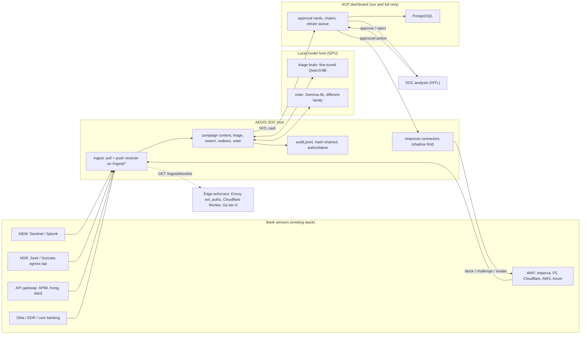

# AEGIS on-prem bank deployment guide

Installing the AEGIS autonomous-SOC subsystem on a bank's own infrastructure, including
air-gapped environments. The reader is a bank CISO / infrastructure team.

AEGIS reads the alerts the bank's existing stack already produces (SIEM, WAF, EDR, identity,
core banking), triages them with a fine-tuned local model, investigates with a swarm of
short-lived workers, plans the smallest containment that protects the crown jewels, and puts
that plan on an approval card for a human. Every decision is evidence, every action goes
through a connector that runs in **shadow mode by default**, and every step is written to a
hash-chained audit log.

**Scope of this guide.** The AEGIS SOC host, the local model host, the alert feeds, the
connectors, and the air-gap bootstrap. The optional ACP dashboard/console (the `soc` and `full`
editions) is the same monolith image documented in
[`docs/enterprise-deployment/01-installation.md`](../enterprise-deployment/01-installation.md)
and [`docs/production-deployment.md`](../production-deployment.md); build it on-prem from the
canonical image in **this** repo (`mahi80/rbi`, root `Dockerfile`) — the older enterprise guide
is cloud-first and clones a repo that is being retired, so take its SSO and sizing *patterns*
and not its `git clone` line.

> Design reference: [`aegis/README.md`](../../aegis/README.md). This guide operationalises
> "Connecting a bank" for an on-prem / air-gapped install; it does not add features.

---

## Contents

1. [Overview and editions](#1-overview-and-editions)
2. [Topology](#2-topology)
3. [Hardware and GPU sizing](#3-hardware-and-gpu-sizing)
4. [Install](#4-install)
5. [Air-gap bootstrap](#5-air-gap-bootstrap)
6. [Network and firewall matrix](#6-network-and-firewall-matrix)
7. [Verify](#7-verify)
8. [Continuous learning (self-evolving loop)](#8-continuous-learning-self-evolving-loop)
9. [Honest limits](#9-honest-limits)

---

## 1. Overview and editions

AEGIS ships in three **editions** from one codebase, selected with `AEGIS_EDITION`.
`aegis/edition.py::apply_edition()` runs first at startup: it fills the edition's defaults for
anything unset and **refuses** contradictory configuration, failing fast with the exact variable
named rather than quietly running the wrong product.

| Edition | Who it is for | ACP dashboard | SDK in the bank's own agents | HITL default |
|---|---|---|---|---|
| **`external`** | A SOC that wants the detection agent only — **nothing of ours in the bank's code**, no ACP dashboard, no `acp-sdk` import | — | — | `file` (or ServiceNow) |
| **`soc`** | External **plus** the ACP console: approval cards, chains, receipts, shadow report, retrain queue | ✅ | — | `dashboard` |
| **`full`** (default) | SOC brain is itself a governed ACP agent, Q ↔ AEGIS bridge on, live intel published to the agent threat-impact scan | ✅ | ✅ | `dashboard` |

What each edition enables, and the environment it **forces** (default when unset) or **forbids**
(startup refuses it) — from `aegis/edition.py`:

| | `external` | `soc` | `full` |
|---|---|---|---|
| Alert feeds, triage, swarm, blast radius, plan, twin | ✅ | ✅ | ✅ |
| WAF / SOAR connectors, shadow mode, receipts | ✅ | ✅ | ✅ |
| Local hash-chained audit (`audit.jsonl`) | ✅ **authoritative** | ✅ | ✅ |
| ACP console: cards, chains, shadow report, dataset, model-promotion queue | — | ✅ | ✅ |
| SOC brain governed under ACPGuard | — | — | ✅ |
| ACP SDK in the bank's own agents, Q37, Q rogue detectors, Q ↔ AEGIS bridge | — | — | ✅ |
| **Forces** (default if unset) | `ACP_GOVERN=0`, `AEGIS_PERSIST=0`, `AEGIS_RULE_FEED=0`, `AEGIS_ENFORCEMENT_MODE=shadow`, `AEGIS_RECEIPTS=1`, `AEGIS_DATASET_CAPTURE=1`, `AEGIS_HITL_TRANSPORT=file` | `ACP_GOVERN=0`, `AEGIS_PERSIST=1`, `AEGIS_RULE_FEED=1`, enforcement `shadow`, `AEGIS_HITL_TRANSPORT=dashboard` | `ACP_GOVERN=1`, `AEGIS_PERSIST=1`, `AEGIS_RULE_FEED=1`, enforcement `shadow`, `AEGIS_HITL_TRANSPORT=dashboard` |
| **Forbids** (startup refuses) | `ACP_DASHBOARD_URL`, `ACP_GOVERN=1`, `acp` in `AEGIS_SOURCES`, `AEGIS_HITL_TRANSPORT=dashboard` | `ACP_GOVERN=1` (governing the brain needs `full`) | — |

A `soc`/`full` deployment that sets no `ACP_DASHBOARD_URL` is **allowed but logged as degraded**
(stdout card, no persistence, no rule feed) — if that is intended, use `external` instead. The
service banner starts with the edition, e.g. `[external] … ungoverned brain — HITL file`.

**Which to pick.** A bank that cannot put any vendor code in its agent codebase, or that is fully
air-gapped with no console, runs **`external`** — the local hash-chained `audit.jsonl` is the
authoritative record and approvals go through ServiceNow or a file queue. A bank that wants the
analyst console and retrain loop on-prem runs **`soc`**. Only a bank that also wants ACP to
govern its *own* AI agents (Q37 infrastructure guard, rogue detectors, the Q ↔ AEGIS bridge)
runs **`full`**.

---

## 2. Topology



Component roles:

| Component | Runs where | Responsibility |
|---|---|---|
| **AEGIS SOC host** | Bank VM / container | The long-running service (`python -m aegis.service`): ingest, triage, swarm, walkers, response, local audit. Needs no inbound internet. |
| **Local model host** | GPU box (can be the same host if it has a GPU) | Serves the fine-tuned triage brain and the voter with no data egress. Alert payloads never leave the bank. |
| **ACP dashboard** | Bank VM (only `soc`/`full`) | Approval cards, chains, receipts, shadow report, retrain/model-promotion queue; PostgreSQL is its store. |
| **SOC analysts** | — | Approve/reject each containment card. In `external`, this is the SOC console (or ServiceNow), not the dashboard; decisions are signed. |
| **Edge enforcers** | Bank's existing edge | Optionally pull `GET /ingest/blocklist` (IPs, CIDRs, fingerprints with expiry) and apply AEGIS's decisions inline, with no vendor API call. |

> In the **`external`** edition the dashboard box is replaced by a ServiceNow instance or a file
> queue; the local `audit.jsonl` remains the authoritative record.

---

## 3. Hardware and GPU sizing

### 3a. SOC host (CPU/RAM) — base service

The base SOC service is stdlib-light (the ingest receiver is pure stdlib; triage and the swarm
call out to the model host). These are starting points, not a validated benchmark — size against
the bank's own alert volume.

| Tier | Alert volume | SOC host | Notes |
|---|---|---|---|
| **Pilot** | ≤ ~5 alerts/s sustained | 2 vCPU, 4 GB, 20 GB disk | One cycle per `AEGIS_POLL_SECONDS` (60); push sources wake the loop in ms |
| **Production** | bursty, with swarm + walkers on | 4 vCPU, 16 GB, 50 GB SSD | Disk for `audit.jsonl`, receipts, HITL journal, feed cache |
| **High-volume** | heavy WAF/CDN push | 8 vCPU, 32 GB | Raise `AEGIS_STREAM_CAPACITY`; terminate TLS at the bank's LB in front of the ingest port |

### 3b. Training the triage model (REAL — from `aegis/finetune/config.py`)

4-bit QLoRA (bitsandbytes nf4) with gradient checkpointing. `preset_for_vram(gb)` picks the
largest model that trains comfortably in the detected VRAM. These numbers are the shipped presets.

| Preset key | HF repo | Min VRAM | Notes |
|---|---|---|---|
| `gemma3-1b` | `google/gemma-3-1b-it` | **6 GB** | Smallest; fast iteration or < 8 GB cards |
| `gemma3-4b` | `google/gemma-3-4b-it` | **8 GB** | Config `DEFAULT` — pairs with AEGIS's existing Gemma backend, zero new plumbing |
| `qwen3-4b` | `Qwen/Qwen3-4B` | **8 GB** | Strong 4B alternative to Gemma |
| `qwen3-8b` | `Qwen/Qwen3-8B` | **12 GB** | Stronger triage model; **`preset_for_vram(12)` returns this** |
| `llama3.1-8b` | `meta-llama/Llama-3.1-8B-Instruct` | **12 GB** | 8B alternative; **gated HF repo**, needs approved HF access |
| `gemma3-12b` | `google/gemma-3-12b-it` | **16 GB** | Largest that fits a 16 GB laptop (RTX 4090 mobile), tight |

Confirm the card with `nvidia-smi --query-gpu=name,memory.total --format=csv`, then pass `--vram`.
Training a few hundred rows is minutes, not hours. Full pipeline and CUDA/WSL gotchas:
[`aegis/finetune/README.md`](../../aegis/finetune/README.md).

### 3c. Inference serving (PROPOSED — validate with a load test)

> **Not yet benchmarked.** The serving tier below is a sizing *proposal*; confirm it against the
> bank's alert rate and latency target before committing hardware. The verdict-latency CI gate
> (`aegis.eval.swarm_timing`) asserts a verdict in < 60 s, not a tokens/sec figure.

| Stage | GPU | Model served | Notes |
|---|---|---|---|
| **Pilot** | 1× 24 GB (A10 / L4 / RTX 4090) | Qwen3-8B, 4-bit | One box; brain + voter can co-reside |
| **Production** | L40S 48 GB or A100 | Qwen3-8B (headroom for voter + concurrency) | Size concurrency to peak alert burst |
| **Production HA** | 2× L40S / A100 | same, replicated | No single point of failure on the verdict path |
| **CPU-only** | — | `gemma3-1b` fp16 | Possible for dev / last-resort only; **not for production** — far too slow for burst load |

### 3d. Model strategy

| Role | Model | How it is served | Why |
|---|---|---|---|
| **Triage brain** | fine-tuned **Qwen3-8B** | `LLM_BACKEND=local AEGIS_MODEL=<adapter>` (`AEGIS_LOCAL_4BIT=1`) | The local HF + PEFT client (`GemmaClient`) already loads Qwen3, so the tuned adapter drops in with no new plumbing. First-pass triage runs sub-second, on-prem; alert payloads never leave the bank. |
| **Voter** | **Gemma-4b** | second local backend (`AEGIS_VOTER_BACKEND`) | Deliberately a **different model family** → an uncorrelated cross-check. Dissent caps confidence and forces a human. This matters most in an air-gap, where the frontier (Anthropic) voter fallback has no egress. |
| **Small-GPU fallback** | **Gemma-4b** (or `gemma3-1b`) | `LLM_BACKEND=local` | The < 12 GB tier when no 24 GB+ card is available. |

`LLM_BACKEND` accepts `mock · local · anthropic · auto`; `local` (alias `gemma`) routes to the
local HF/PEFT client for **any** adapter named by `AEGIS_MODEL` — Gemma, Qwen3 or Llama.

**Trade-off a bank may choose:** run **Qwen-only** (the brain also acts as voter). This is a
weaker, same-family cross-check — errors are more correlated, so fewer disagreements force a
human. Keeping the Gemma-4b voter is the recommended default; Qwen-only is a documented, accepted
trade-off for a bank that wants to serve a single model.

PII tokenization (`AEGIS_PII_TOKENIZATION=1`, default) runs **before** any model call.

---

## 4. Install

> **Shortcut.** `install.sh` at the repo root performs steps 4a–4e (system user, venv, `/etc/aegis/aegis.env`,
> licence, hardened `aegis-soc.service`) in one run — `sudo ./install.sh` interactive, or fully flagged
> (`--community`, `--code`, `--license`, `--llm vllm --vllm-url …`, `--sources`, `--non-interactive`). It is
> idempotent and keeps the licence, the dataset salt and the audit log across re-runs. For an air-gapped host,
> copy the repo and run it with `--license <file>` (or `--no-license`); the steps below remain the reference
> for what it does and for environments that need a different layout.

Two profiles. The **base SOC** profile is pip-light and is all the SOC host needs when the model
is served from a separate GPU box. The **local-inference** profile adds the GPU stack and is
installed on the model host (or on the SOC host if it has a GPU).

| Profile | Requirements file | Pulls | Install on |
|---|---|---|---|
| **Base SOC** | `aegis/requirements.txt` | `pydantic`, `anthropic`, `python-dotenv`, `pyyaml` (small, pure-python) | SOC host |
| **Local inference** | `aegis/requirements-finetune.txt` | `torch`, `transformers`, `peft`, `trl`, `datasets`, `bitsandbytes`, `accelerate` (+ `unsloth` on Linux; multi-GB, needs NVIDIA GPU + CUDA 12.x) | GPU / model host |

> The `anthropic` package is a base dependency but is **only** used when a frontier voter/judge is
> configured; an air-gapped `external` install never calls out with it.

### 4a. Base SOC host

```bash
python -m venv /opt/aegis/venv && source /opt/aegis/venv/bin/activate
pip install -r aegis/requirements.txt
```

### 4b. Local-inference (model) host

```bash
python -m venv ~/.venvs/aegis-ft && source ~/.venvs/aegis-ft/bin/activate
pip install -r aegis/requirements-finetune.txt     # unsloth-first; transformers+peft fallback
```

Train / gate / promote the triage model per [`aegis/finetune/README.md`](../../aegis/finetune/README.md).
The promoted adapter is picked up by the service through `AEGIS_MODEL` (or
`AEGIS_MODEL_POINTER=$RUNS/retrain/current.json` on `soc`/`full`) at its next restart.

### 4c. Key environment (`.env`)

Place the SOC host's config in an `.env` (loaded by `python-dotenv`) or export it. The exact AEGIS
env for the SOC host follows the project deploy checklist.

| Variable | Example | Notes |
|---|---|---|
| `AEGIS_EDITION` | `external` \| `soc` \| `full` | The one switch; validated at startup |
| `AEGIS_SOURCES` | `sentinel,waf,splunk` | Alert feeds (see §6 / README "Connecting a bank"). `acp` is `full`-only |
| `ACP_DASHBOARD_URL` | `https://dashboard.internal` | **`soc`/`full` only** — forbidden in `external` |
| `ACP_API_KEY` | `sk-…` | Dashboard auth (`soc`/`full`) |
| `ACP_GOVERN` | `1` | **`full` only** — governs the SOC brain under ACPGuard |
| `AEGIS_SWARM` | `1` | Fan-out enrichers (≤ 60 s, inline) |
| `AEGIS_WAF_VENDOR` | `imperva` \| `f5` \| `cloudflare` \| `aws` \| `azure` \| `mock` | + that vendor's creds (§6, README connector table) |
| `AEGIS_SOAR_VENDOR` | `xsoar` \| `sentinel` \| `mock` | + `AEGIS_SOAR_*` creds |
| `AEGIS_ENFORCEMENT_MODE` | `shadow` | **Keep `shadow`** until the two-week shadow window says otherwise |
| `AEGIS_AUTO_BLOCK` | `shadow` | Tiered auto-block for fast agent attacks; `off` \| `shadow` \| `live`, default `shadow` |
| `AEGIS_DATASET_SALT` | `<secret>` | Dataset capture is on by default; the salt pseudonymises captured rows — treat as a secret |
| `LLM_BACKEND` | `local` \| `vllm` | `local` = in-process HF/PEFT, no egress; `vllm` = a served endpoint (§8, for throughput + hot-reload); `mock` for smoke |
| `AEGIS_MODEL` | `/opt/aegis/models/triage-qwen3-8b` | The adapter / snapshot path |
| `AEGIS_LOCAL_4BIT` | `1` | 4-bit load on the GPU |
| `AEGIS_VOTER_BACKEND` | `local` | The different-family (Gemma) voter |
| `AEGIS_HITL_TRANSPORT` | `file` \| `servicenow` \| `dashboard` | Defaulted per edition |
| `AEGIS_INGEST_HTTP` | `1` | Start the push receiver (or just set a bind) |
| `AEGIS_INGEST_BIND` | `0.0.0.0:8787` | Default bind; put the bank's LB/reverse proxy in front for TLS |
| `AEGIS_INGEST_TOKEN` | `<secret>` | **Required off loopback**; bearer token on every `/ingest/*` call |
| `AEGIS_INGEST_READ_TOKEN` | `<secret>` | Optional; when set, `GET /ingest/verdicts`, `/ingest/blocklist`, `/ingest/license` need this token instead of the push token — relays that only push cannot read verdicts. `install.sh` writes both |
| `AEGIS_CONSOLE_TOKEN` | `<secret>` | The analyst console's key (`soc-console` `AEGIS_API_KEY`): reads `/api/soc/chains`, `/api/approvals`, `/api/soc/proposals` and may `POST` a decision, which lands in `<AEGIS_HITL_DIR>/decisions.jsonl` with `decided_by` = the console's signed-in role:user. Unset → the console is read-only. `install.sh` writes it |
| `AEGIS_AUDIT_MAX_MB` | `512` | Rotate the audit log at this size (`audit.jsonl.<ms>`); the hash chain continues across segments — `python -m aegis.audit verify --all` walks them as one |
| `AEGIS_AUDIT_FSYNC` | `1` | fsync every audit row (set `0` only on a WORM/replicated mount that guarantees durability itself) |
| `AEGIS_NETOPS_STATE` | `<audit dir>/netops-state.json` | Network-assurance checkpoint (links, open incidents, learned roles) written every 5 s and on shutdown; restored on start so a restart mid-outage does not re-alert. Empty string disables |
| `AEGIS_FEED_WATCHDOG` | `1` | Alert when a feed goes **silent** (a dead push feed is not "no attacks"); tune with `AEGIS_FEED_SILENCE_SECONDS` / `AEGIS_FEED_EXPECT`. Exposes `aegis_feed_silent` on `/metrics` |
| `AEGIS_VLLM_URL` | `http://gpu-host:8000/v1` | With `LLM_BACKEND=vllm`: the served (OpenAI-compatible) endpoint. Also `AEGIS_VLLM_MODEL`, `AEGIS_VLLM_API_KEY` |
| `AEGIS_HOT_RELOAD` | `1` | **`soc`/`full`** — apply an approved model promotion at runtime, no restart (vllm backend); reads the pointer below (§8) |
| `AEGIS_MODEL_POINTER` | `/var/lib/aegis/retrain/current.json` | The promotion pointer the retrain loop writes; hot-reload and `local`-backend startup both read it |

Full variable list: [`aegis/README.md` → Configuration reference](../../aegis/README.md#configuration-reference).

### 4d. Run as a container

No AEGIS container image ships today (the repo's root `Dockerfile` builds the ACP dashboard
monolith). Build a thin SOC image from the checkout — example only, adapt to the bank's base
image and secrets policy:

```dockerfile
# example SOC-host image — the bank builds and signs this
FROM python:3.12-slim
WORKDIR /app
COPY aegis/requirements.txt /app/aegis/requirements.txt
RUN pip install --no-cache-dir -r /app/aegis/requirements.txt
COPY aegis/ /app/aegis/
ENV PYTHONUNBUFFERED=1
# config comes from --env-file at run time, never baked into the image
ENTRYPOINT ["python", "-m", "aegis.service"]
```

```bash
docker build -t aegis-soc:local -f Dockerfile.aegis .
docker run -d --name aegis-soc --restart unless-stopped \
  --env-file /etc/aegis/soc.env \
  -p 8787:8787 \
  -v /var/lib/aegis:/var/lib/aegis \
  aegis-soc:local --audit /var/lib/aegis/audit.jsonl
```

For a `full`/`soc` deployment that governs the bank's own agents on Kubernetes, the agent-layer
Helm chart and its **NetworkPolicy egress allowlist** (deny-all except DNS, the model endpoint,
SIEM REST and ServiceNow REST) are the reusable air-gap egress model —
see [`aegis/k8s/README.md`](../../aegis/k8s/README.md).

### 4e. Run as a systemd service

```ini
# /etc/systemd/system/aegis-soc.service
[Unit]
Description=AEGIS autonomous SOC
After=network-online.target
Wants=network-online.target

[Service]
Type=simple
User=aegis
WorkingDirectory=/opt/aegis/app
EnvironmentFile=/etc/aegis/soc.env
ExecStart=/opt/aegis/venv/bin/python -m aegis.service --audit /var/lib/aegis/audit.jsonl
Restart=always
RestartSec=5
# the service polls every AEGIS_POLL_SECONDS (default 60); push sources wake it immediately

[Install]
WantedBy=multi-user.target
```

```bash
sudo systemctl daemon-reload
sudo systemctl enable --now aegis-soc
journalctl -u aegis-soc -f        # the banner prints the edition and model backend
```

> `audit.jsonl` is append-only across restarts (the service never truncates it). Put
> `/var/lib/aegis` on durable storage and back it up — it is the authoritative record,
> especially in `external`.

### 4e½. The index: where the console's queries run

`audit.jsonl` is the record (hash-chained, append-only, fsynced, verifiable offline). It is not a database, and
the console should not be scanning it. Every chain is therefore also inserted — after its JSONL append is
durable — into a **derived index** through one SQLAlchemy ORM (`aegis/store/`). Pick the database by URL;
the models, queries and the console do not change:

| `AEGIS_INDEX_URL` | When |
|---|---|
| `duckdb:////var/lib/aegis/index.duckdb` (default, `install.sh` writes it) | single host, zero setup, fast analytics for the shadow report |
| `sqlite:////var/lib/aegis/index.sqlite` | single host, the most conservative embedded choice |
| `postgresql+psycopg2://aegis:…@db.bank.internal/aegis` (`pip install bluedefence[postgres]`) | the bank's own PostgreSQL; several SOC hosts, one console |
| `mssql+pyodbc://aegis:…@sql.bank.internal/aegis?driver=ODBC+Driver+18+for+SQL+Server` (`pip install bluedefence[mssql]`) | the bank standardises on SQL Server |

Rules the index keeps: it is **derived** (the JSONL set is the backup; `python -m aegis.store reindex`
rebuilds it, `stats` reports it), **idempotent** (`integrity_hash` is UNIQUE, so replay and retries are
harmless), **never load-bearing** (an insert failure marks it `stale` — visible on `/healthz` with the read
token — and the console falls back to scanning the file until a reindex), and **append-only** (the code has
no update or delete for chains or decisions; on PostgreSQL / SQL Server give the service a role with INSERT
and SELECT only — retention is by dropping whole audit segments together with their rows). Schema: integer
keys with explicit sequences, VARCHAR/TEXT, DATETIME, FLOAT — nothing dialect-specific.

### 4f. Analyst console (`soc` / `full` only)

The console is `soc-console/` (Next.js), served on the SOC host itself — no second product. It reads
incidents, evidence and HITL cards from the host's own push receiver (`AEGIS_API_ORIGIN=http://127.0.0.1:8787`,
`AEGIS_API_KEY=<AEGIS_CONSOLE_TOKEN>`), which answers `/api/soc/chains`, `/api/approvals` and
`/api/soc/proposals` from `audit.jsonl` and the HITL directory. An analyst's approve/reject goes through
the console's server-side route (session checked, role must be `admin`/`cio`/`ciso`/`bu_head`) to
`POST /api/approvals/{id}/approve|reject` on the host, which appends to `decisions.jsonl` — the file the
service executes from on its next cycle — with `decided_by` recorded. Sign-in: `AEGIS_AUTH_MODE=local`
(named accounts, scrypt) for pilots, `oidc` (Entra ID / SAML-federated, group → role map) for production;
see `soc-console/README.md`. `deploy/aws-pilot/` shows the whole wiring under systemd + nginx. The
**`external`** edition has no console; approvals are ServiceNow or the file queue.

### 4g. Agent Q — ask the detection (`soc` / `full`)

The console includes **Agent Q**, a copilot an analyst opens to ask what AEGIS detected, scoped to
the selected incident ("why flagged?", "what's at risk?", "what should I do?"). By default it answers
**deterministically from the evidence chain** — verdict, blast radius (reached assets, crown jewels,
the min-cut choke point), recommended actions, who investigated — so it needs no LLM and can't
hallucinate facts the chain doesn't contain.

To route **free-text** questions to the bank's own LLM-backed Q (the ACP dashboard's Q chat), set on
the console host:

| Env | Value | Notes |
|---|---|---|
| `AEGIS_ASK_URL` | `https://dashboard.internal/api/…/ask` | The bank's Q endpoint. Unset → deterministic answers only (no egress) |
| `AEGIS_API_KEY` | `sk-…` | Sent as `X-API-Key` to that endpoint |

The console forwards the question **with the detection as context** and **falls back to the
deterministic answer** if the endpoint is unreachable. Nothing leaves the console beyond what the
evidence chain already holds (which is PII-tokenised upstream).

---

## What happens when the box misbehaves

| Fault | Behaviour |
|---|---|
| Process killed mid-write (kill -9, power) | On start the torn last audit row is moved to `audit.jsonl.torn-<ts>` and the chain resumes from the last intact entry; the network detector reloads its checkpoint (open incidents, link states) so the outage in progress is still one incident |
| Disk full / read-only mount | Triage continues, **no action is executed** for an alert whose evidence could not be written (fail closed); `/healthz` returns 503 with `audit.degraded=true`; one log line per cycle, not per alert; recovers by itself when space returns |
| Audit log grows | Rotated at `AEGIS_AUDIT_MAX_MB`; segments stay verifiable as one chain |
| Feed storm | The receiver answers 503 when its queue is full (senders retry; nothing is dropped silently); the loop drains in bounded batches |
| Exporter with a broken clock | Timestamps in ms/µs/ns are scaled; absurd ones are clamped to the host clock; a single bad exporter cannot declare the estate dead |
| Service hung | the unit is `Type=notify` with `WatchdogSec=180`: the service pings systemd every cycle and every second while idle; a hung model call or a deadlock gets it restarted; the checkpoint makes the restart cheap |
| Feed storm beyond what the model can triage | **storm mode**: when the receiver queue passes `AEGIS_STORM_QUEUE_PCT` (80 %) or a cycle exceeds `AEGIS_STORM_ALERTS` (500), model-bound alerts are spilled to `deferred.jsonl` (bounded) and only deterministic fast paths (network faults, egress, honeytokens, auth bursts…) run; when it clears, the backlog is re-fed `AEGIS_STORM_DRAIN` (200) per batch for up to half the poll interval each cycle. Nothing is dropped; `--status` shows the backlog. The same spill parks alerts whose audit row could not be written (full or read-only audit disk) and re-parks them until it can be. `AEGIS_DEFERRED_PATH` (default: beside the audit log) has a fallback on another volume, `AEGIS_DEFERRED_FALLBACK` (default: the system temp dir; `off` disables it), so a full audit disk does not also refuse the spill |
| A re-run of `install.sh` ships a bad release | the new release must pass a 60-s health check (`READY` + `/healthz`); otherwise the installer checks out the previous commit, reinstalls and restarts, and says so |
| Box lost / rebuild | `aegis-backup` (config, licence, salt, audit chain, HITL journals, cursors, checkpoint; `--with-models` for adapters) → `aegis-restore <tar>` on the new box; the audit chain is verified after restore |

`python -m aegis.service --status` prints receiver health, audit writability and chain state, checkpoint age, licence and storm backlog in one screen (exit 1 when anything is wrong — usable from monitoring).

Verify the chain any time: `python -m aegis.audit verify --audit /var/lib/aegis/audit.jsonl --all` (exit 1 and the file:line on the first break).
| Audit log unwritable (disk full, read-only) | nothing executes (fail closed); the alert is parked in the deferred queue and re-fed once the log is writable; `/healthz` → 503 `degraded` |
| A source API down mid-cycle (Sentinel 503, bad bearer) | that source's pass ends with one ERROR line; other sources and the next cycle carry on |
| A crash between `pop` and processing of deferred alerts | the batch is re-delivered after restart (`ack` moves the cursor only after processing) |
| A corrupt row in the middle of `audit.jsonl` | left in place and reported by `verify` (`broken_at`); only a torn *tail* is repaired at start |
| `--status` / `verify` / reports run beside the live service | read-only (`repair=False`): never truncate a row being written |
| Audit rotation between two contributions | the contribution cursor is segment-aware (`{ino, offset}`): nothing is skipped or re-sent |

## 5. Air-gap bootstrap

Everything AEGIS needs at runtime can be staged offline. Three things must be brought in across
the air-gap and refreshed on a schedule.

| What to stage | How | Notes |
|---|---|---|
| **Model weights + adapter** | Download the base model and the fine-tuned adapter on a connected box, copy to the air-gapped model host, point `AEGIS_MODEL` at the local path | **`meta-llama/Llama-3.1-8B-Instruct` is a gated HF repo** — accept its licence and authenticate before download. Gemma and Qwen3 are ungated. Set `HF_HUB_OFFLINE=1` on the air-gapped host |
| **Python wheels** | `pip download -r aegis/requirements.txt -d wheelhouse/` (and `requirements-finetune.txt` for the GPU box), copy `wheelhouse/`, then `pip install --no-index --find-links wheelhouse/ -r …` | Build the finetune wheelhouse on a box with the **same OS, Python and CUDA** as the target — `torch`/`bitsandbytes` wheels are platform-specific |
| **CVE / KEV / threat-intel feed cache** | Pre-seed the cache dir (`AEGIS_TI_CACHE`) with CISA KEV + NVD 2.0 + EPSS pulls; refresh on a cadence by syncing the cache across the gap | `AEGIS_CVE_INTEL=1` enables the feeds; `NVD_API_KEY` raises the rate limit on the connected side |

**What degrades without egress, and how:**

| Dependency | Without egress | Behaviour |
|---|---|---|
| KEV / NVD / EPSS feeds | No live CVE enrichment | **Last good cache** is kept and used; a fetch failure logs `WARNING KEV fetch failed`, never drops an alert |
| Rule feed (self-evolving detection rules, `soc`/`full`) | No new rules | **Last good rules** kept; feed outage is non-fatal |
| Frontier voter/judge (`anthropic`) | Not reachable | Run the **local Gemma voter** instead. A missing voter is counted as **dissent → HITL**, so a benign alert is never auto-closed by a missing voter — it is escalated to a human |
| Dashboard (if `soc`/`full` and briefly unreachable) | — | stdout card; the **local `audit.jsonl` stays authoritative**; pending approvals are journalled and replayed |

The design rule: **no dependency failure drops an alert silently or lets a broken model close
one.** The air-gap simply makes "last good cache" the normal operating mode for the intel feeds,
and makes the local voter mandatory. This is exercised by the `aegis.eval.fault_injection` gate,
which includes the external-edition-with-no-dashboard and push-receiver scenarios.

---

## 6. Network and firewall matrix

AEGIS needs **no inbound internet**. Inbound is only from the bank's own sensors and edge; most
of the edition difference is on the outbound side.

| Direction | Flow | Port / protocol | Auth | `external` | `soc` / `full` |
|---|---|---|---|---|---|
| **Inbound** | Sensors push events → `POST /ingest/*` (cloudflare, firehose, waf, apigw, ndr, alerts) | `AEGIS_INGEST_BIND`, default **`0.0.0.0:8787`**, HTTP behind the bank's TLS LB | **`AEGIS_INGEST_TOKEN`** bearer (`Authorization: Bearer`, `X-Amz-Firehose-Access-Key`, or `X-AEGIS-Token`); required off loopback | ✅ | ✅ |
| **Inbound** | `GET /healthz` (queue depth + counters) | same port | none | ✅ | ✅ |
| **Outbound (pull)** | Edge enforcers pull `GET /ingest/blocklist` (active IPs / CIDRs / fingerprints with expiry) | same port | same token; shadow (dry-run) receipts are never served | ✅ | ✅ |
| **Outbound** | Poll SIEM — Sentinel (Log Analytics) / Splunk (REST) | HTTPS 443 | workspace / token creds | ✅ | ✅ |
| **Outbound** | Act on WAF / SOAR vendor APIs (Imperva, F5, Cloudflare, AWS WAF, Azure WAF, XSOAR, Sentinel playbooks) | HTTPS 443 | per-vendor least-privilege creds | ✅ | ✅ |
| **Outbound** | Model host (if separate) | bank-internal (gRPC/HTTP to the serving endpoint) | internal | ✅ | ✅ |
| **Outbound** | ACP dashboard — cards, chains, receipts, rule feed, retrain queue | HTTPS to `ACP_DASHBOARD_URL` | `ACP_API_KEY` | **—** (forbidden) | ✅ |
| **Outbound** | Frontier voter/judge (Anthropic) | HTTPS 443 | `ANTHROPIC_API_KEY` | optional; **omit in air-gap** (use local voter) | optional |
| **Outbound** | CVE / KEV / NVD / EPSS feeds | HTTPS 443 | optional `NVD_API_KEY` | optional (or pre-seed cache) | optional (or pre-seed cache) |

Push vs poll: a polled source is read once per `AEGIS_POLL_SECONDS`; a pushed event wakes the
loop and gets a verdict in milliseconds. The push queue is bounded — when full the receiver
answers **503** and the vendor retries (Firehose backs the batch up to S3); nothing is silently
dropped, and re-delivered batches dedupe on the vendor event id. Other replies: **200** accepted,
**401** bad token, **413** body over `AEGIS_INGEST_MAX_MB` (64), **415** wrong shape.

Terminate TLS at the bank's load balancer / reverse proxy in front of `8787`. For a Kubernetes
`full` deployment, the agent-layer NetworkPolicy denies all egress except the explicit allowlist
(DNS, model endpoint, SIEM REST, ServiceNow REST) — see [`aegis/k8s/README.md`](../../aegis/k8s/README.md).

---

## 7. Verify

Smoke the install on the bank's own environment, in order.

**1. Service health and banner.**

```bash
systemctl status aegis-soc
journalctl -u aegis-soc -n 20     # banner should name the edition, e.g. [external] … HITL file
curl -s http://127.0.0.1:8787/healthz     # {"ok": true, "queue": 0, ...}
```

**2. One cycle (the canonical smoke).**

```bash
python -m aegis.service --once            # one pass over the configured sources, exits 0
python -m aegis.eval.fault_injection      # whole pipeline with each dependency failing in turn
```

**3. Push a test alert and watch it get a verdict.**

```bash
curl -sS -X POST http://127.0.0.1:8787/ingest/alerts \
  -H "Authorization: Bearer $AEGIS_INGEST_TOKEN" \
  --data-binary '{"id":"smoke-001","source":"test","severity":"high","summary":"on-prem smoke test"}'
# → 200 {"ok": true, "accepted": 1, "rejected": 0}
```

**4. A chain appears, and an approval card is filed.**

- `external` / file transport: the card lands in `cards.jsonl`; approve it in the SOC console, or on the
  host with the signed CLI (a hand-appended, unsigned line is ignored once `AEGIS_CONSOLE_TOKEN` is set);
  the next cycle executes it through the (shadow) connector → receipt:
  ```bash
  cat $AEGIS_HITL_DIR/cards.jsonl
  python -m aegis.hitl decide <id from a card> approve --by analyst:name
  ```
- `soc` / `full`: the card appears on the ACP **Approvals** page; approve/reject with a rationale.
- Confirm the hash-chained audit: the chain and its `governance_block`/receipt rows are in
  `audit.jsonl`.

**5. Edge blocklist (if an edge enforcer is wired).**

```bash
curl -sS http://127.0.0.1:8787/ingest/blocklist -H "Authorization: Bearer $AEGIS_INGEST_TOKEN"
# → {"generated_at": …, "ips": [...], "fingerprints": [...]}  (dry-run receipts excluded)
```

Keep `AEGIS_ENFORCEMENT_MODE=shadow` and `AEGIS_AUTO_BLOCK=shadow` through the two-week shadow
window, then `python -m aegis.shadow report` lists what is ready to go live, lowest blast radius
first.

---

## 8. Continuous learning (self-evolving loop)

The triage model keeps improving from two **real** signals — the bank's own analyst decisions and
the CVE database — and **every weight change is gated by a human**. The model never changes its own
weights in production; a person signs each promotion, and a hard eval gate runs first.

> **What this is, precisely** (a bank will ask): supervised fine-tuning from analyst-corrected
> labels plus CVE-calibrated data, with an absolute eval gate, a shadow comparison against the
> current model, and a **human-approved** promotion. It is **not** autonomous reinforcement learning —
> the DPO/RL-from-approvals variant is research (`aegis/rl/`), not wired. Nothing self-promotes.

```
analyst corrections + CVE-calibrated data ─(nightly)→ train → gate → shadow-vs-current
      → model_promotion proposal → dashboard approvals queue → a human approves
      → sync writes the pointer + loads the adapter into vLLM → SOC hot-reloads → live, no restart
```

The trainer runs as its **own process on the GPU/training host** so a fine-tune never blocks the SOC
triage loop.

### 8a. Trainer daemon (GPU/training host)

`python -m aegis.finetune.trainer_loop` runs two cadences: a slow **train** cadence (produces
proposals) and a fast **sync** cadence (applies approvals to the live pointer).

| Env | Example | Notes |
|---|---|---|
| `AEGIS_TRAINER_LOOP` | `1` | Enable the daemon (refuses to run without it) |
| `AEGIS_TRAINER_RUNS` | `/var/lib/aegis/retrain` | Run/state/`current.json` live here (share with the SOC host's `AEGIS_MODEL_POINTER`) |
| `AEGIS_TRAINER_BASE_DATA` | `/opt/aegis/data/public-v5` | Realistic base set the analyst rows are merged into |
| `AEGIS_TRAINER_PRESET` | `qwen3-8b` | Train preset (`aegis/finetune/config.py`) |
| `AEGIS_TRAINER_INTERVAL` | `86400` | Train cadence seconds (daily) |
| `AEGIS_TRAINER_SYNC_INTERVAL` | `300` | Sync cadence seconds (apply approvals within minutes) |
| `AEGIS_TRAINER_MIN_ROWS` | `50` | Skip a cycle until this many new analyst rows exist |
| `AEGIS_VLLM_REGISTER` | `1` | After sync, load the promoted LoRA into vLLM so `set_model` resolves |
| `ACP_DASHBOARD_URL` / `ACP_API_KEY` | | Pull analyst decisions, ship proposals, read approvals |

```ini
# /etc/systemd/system/aegis-trainer.service  (GPU/training host)
[Unit]
Description=AEGIS self-evolving trainer
After=network-online.target
[Service]
Type=simple
User=aegis
EnvironmentFile=/etc/aegis/trainer.env
ExecStart=/opt/aegis/venv/bin/python -m aegis.finetune.trainer_loop
Restart=always
RestartSec=30
[Install]
WantedBy=multi-user.target
```

### 8b. The human gate (who promotes)

A trained candidate that passes the gate **and** beats the current model in shadow becomes a
`model_promotion` proposal in the dashboard approvals queue (`GET /api/soc/proposals`). A **CISO /
CIO / BU-head** approves it — in the console's model-loop strip, or `POST /api/soc/proposals/{id}/decide`.
Only an approval lets `sync` write the pointer. Offline fallback: `python -m aegis.finetune.retrain
promote --approved-by <name> --rationale "<why>"`. Every decision is audited (who + role + rationale).

### 8c. Serving + hot-reload (SOC / inference host)

Serve the model with vLLM for throughput and runtime adapter-swap: `LLM_BACKEND=vllm`,
`AEGIS_VLLM_URL=http://gpu-host:8000/v1`, and start vLLM with `VLLM_ALLOW_RUNTIME_LORA_UPDATING=1`.
Set `AEGIS_HOT_RELOAD=1` and point `AEGIS_MODEL_POINTER` at the trainer's `current.json`: an approved
promotion then swaps the live model **with no restart**. (On the `local` backend a promotion applies
at the next restart instead — the reload reports that rather than pretending it swapped.)

### 8d. The CVE database (KEV / NVD / EPSS)

AEGIS consumes CISA-KEV + NVD + EPSS as both live enrichment and a training calibration source.

- **Refresh / cache**: `python -m aegis.agents.threat_intel.cve_feeds refresh --days 7` (set
  `NVD_API_KEY` for the higher NVD rate limit). Set `AEGIS_CVE_INTEL=1` to use it live at inference.
  Air-gapped: pre-seed the cache (`AEGIS_TI_CACHE`) via the bootstrap in §5 — no feed egress at run time.
- **Training calibration** (`--cve-calibrate` on `build-public` / `synth`): the synthetic CVE overlay
  is tuned to the **real** KEV/NVD/EPSS distributions (how often high-severity CVEs are actually
  exploited, the real CVSS-band spread, exploit-maturity mix). **Only aggregate statistics are
  used — never a real CVE id/payload in training data**; the real facts arrive via live enrichment at
  inference, where they stay current. Inspect the derived calibration with
  `python -m aegis.dataset.cve_calibration`.

Feed egress is the CVE/KEV/NVD/EPSS row in §6; in air-gap it is pre-seeded, so this section needs no
run-time internet.

---

## 9. Honest limits

These are stated plainly so the bank can plan the onboarding build and set expectations. From
`aegis/README.md` ("Honest limits" and "Connecting a bank").

| Area | Limit |
|---|---|
| **Blast radius / walkers** | Run on a **MockTenant** until the bank's `TelemetrySource` adapter exists (sessions per user, lateral logons per host, flows per IP, roles per principal, tables queried, account beneficiaries). **Writing that adapter is the main onboarding build** (`walkers/sources.py`). |
| **WAF / SOAR connectors** | Built to the **public API shapes** and tested against **mock tenants** with injected faults (429/5xx, lock-token and etag races, bad signatures). Each still needs **one live-tenant smoke**; the first real run may need a field renamed. |
| **Enforcement** | **Shadow by default.** Connectors record what they *would* do and go to a human; nothing hits a vendor until you flip to `live` after the shadow window. |
| **Confidence** | **Policy-calibrated** (the corroboration rule + the voter cap), **not yet statistically calibrated** against analyst outcomes — that needs a few hundred decided alerts from a live deployment. |
| **Detection quality** | Measured on **held-out sets**, not yet on a live tenant; the two-week shadow window is what turns "built" into "measured". |
| **Coverage** | **What the bank doesn't log, AEGIS can't see.** No WAF/CDN logs → no agentic-chain detection on the web tier. Retry-after-stop needs the WAF's *stop* events; fingerprint following needs JA4/JA3 in the logs (Cloudflare Bot Management, AWS WAF). |
| **BOLA / object-walk** | Needs API-gateway logs **with the principal** plus an **ownership source**; with WAF logs only it is invisible, without ownership it only reaches *suspicious*. |
| **Latency** | Pushed sources (Logpush, Firehose, Event Hub) reach a verdict in ms; **polled sources (Sentinel, Splunk) wait for the poll interval**, and vendor-side batching adds its own delay (set Firehose's buffer to the minimum). |
| **Low-and-slow** | One request every few minutes is **below every cadence signal by design** — undetected (shown by the purple-team report). |
| **Research components** | RL (`rl/`) and moving-target defense (`mtd/`) are **research only, not on the verdict path**. |

---

*Companion docs: [`aegis/README.md`](../../aegis/README.md) (design + full config reference),
[`aegis/finetune/README.md`](../../aegis/finetune/README.md) (model training),
[`aegis/k8s/README.md`](../../aegis/k8s/README.md) (K8s egress-allowlist model),
[`docs/enterprise-deployment/01-installation.md`](../enterprise-deployment/01-installation.md)
(ACP dashboard install + SSO patterns).*
